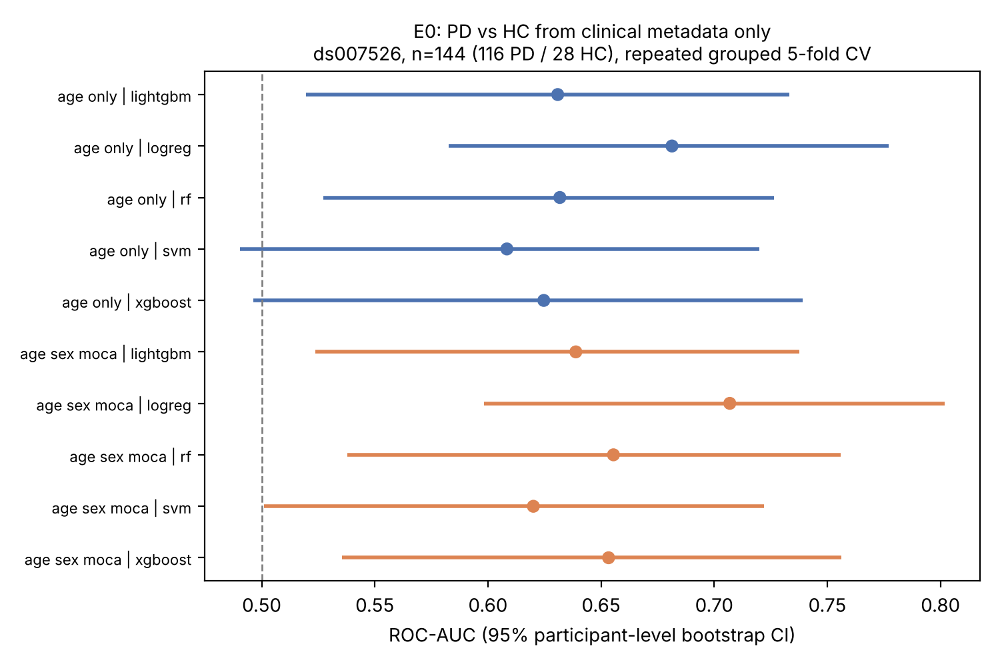

# Multilevel Prediction of Alzheimer's and Parkinson's Disease Using Clinical, Neuroimaging and EEG Features with External Validation

A reproducible, leakage-safe multimodal machine-learning framework for Alzheimer's disease (AD) and Parkinson's disease (PD) detection, severity assessment and independent external validation, built on real, openly licensed or access-controlled patient datasets only. **Research prototype: not a clinically validated diagnostic device.**

## Project status (read this first)

| Component | Status |
|---|---|
| Dataset audit of ds007526, ds002778 (counts, variables, licences, access) | **Completed**, verified from source metadata (`docs/dataset_audit.md`) |
| PD clinical-metadata baselines (E0 PD vs HC, E1 UPDRS-III in PD) and extended analyses A1-A5 (paired model comparison, calibration, age-matched sensitivity, sex subgroups, nested CV) on ds007526 | **Completed**, real data, results below |
| EEG preprocessing, feature extraction, within-cohort and cross-cohort external validation, domain-shift diagnostics, late fusion, SHAP | **Implemented and unit-tested on toy fixtures; not run on real EEG.** The EEG signal files could not be downloaded in the build environment. |
| Alzheimer's pipeline (OASIS-3, ADNI) | **Planned only.** Needs approved data access; nothing trained, nothing reported. |
| PPMI | **Planned.** Application + DUA required; not accessed. |
| Notebooks 01 (exploration) and 03 (PD analysis) | **Completed and executed**; 02 (AD) and 04 (external validation) are placeholders stating "not run" |
| CNN/EEGNet/transformer models | **Not done** (not justified at n=144 / n=31) |

No synthetic or randomly generated data is used as experimental evidence anywhere in this repository. Unit tests use tiny hand-built fixtures to test code and are never used for results.

## Papers

Two preprints (not peer reviewed) are in [`paper/`](paper/), each with Markdown source and PDF:

1. [`paper1_age_confounding.pdf`](paper/paper1_age_confounding.pdf): *Age imbalance accounts for the discriminative value of clinical metadata for Parkinson's disease in an open cohort: a leakage-safe evaluation* (ds007526; experiments E0, E1, A1-A5).
2. [`paper2_cohort_audit.pdf`](paper/paper2_cohort_audit.pdf): *A verified audit of two open Parkinson's disease EEG cohorts (OpenNeuro ds007526 and ds002778): composition, clinical variables, acquisition differences and data-quality notes.*

Rebuild with `pandoc paper/<name>.md -o paper/<name>.pdf --pdf-engine=xelatex --resource-path=paper:.`; audit tables with `python scripts/audit_tables.py`.

## Research problem and questions

Open PD and AD datasets are small and heterogeneous, and many published classifiers are evaluated within a single cohort with unclear leakage control. This project asks:

1. **RQ1.** How well can PD be separated from healthy controls using clinical, EEG, and combined features when evaluation is strictly participant-level?
2. **RQ2.** How much of that performance survives independent external validation on a different cohort, and how large is the domain shift (montage, amplifier, site, demographics)?
3. **RQ3.** How much apparent signal is demographic confounding (e.g. age imbalance) rather than disease-related physiology?
4. **RQ4.** (AD, planned) Do OASIS-3 and ADNI support cross-cohort CN/MCI/AD and severity prediction with harmonised variables?

## Datasets

| Dataset | Disease | Participants (verified unless noted) | Access | Status |
|---|---|---|---|---|
| OpenNeuro ds007526 v1.0.2 | PD | 144 (116 PD, 28 HC); 277 EEG recordings (4.26 GB); item-level UPDRS and 39 PD follow-ups in `sourcedata/` | CC0 (page asks users to contact the authors) | metadata used; EEG pending download |
| OpenNeuro ds002778 v1.0.5 | PD | 31 (15 PD, 16 HC); 46 EEG recordings | CC0 (contact maintainers before publishing) | metadata audited; EEG pending download |
| PPMI | PD | not verified | application + DUA | not accessed |
| OASIS-3 | AD | 1,378 per website (not verified at participant level) | NITRC-IR + DUA | not accessed |
| ADNI | AD | not verified | application + DUA | not accessed |

Full audit, variables and caveats: [`docs/dataset_audit.md`](docs/dataset_audit.md).

## Methodology

Identical EEG preprocessing for all cohorts (1-45 Hz band-pass, mains notch, 250 Hz, average reference, 4 s windows, amplitude rejection), spectral and time-domain features collapsed to one vector per recording (median over windows), pipelines of imputation/scaling/feature-selection/estimator fitted inside training folds, repeated stratified **group** cross-validation, participant-level bootstrap confidence intervals, calibration (Brier, ECE), and external validation with explicit domain-shift diagnostics. Details: [`docs/methodology.md`](docs/methodology.md), [`docs/experimental_protocol.md`](docs/experimental_protocol.md).

Model zoo: logistic regression, random forest, SVM, XGBoost, LightGBM (classification); ridge and random forest (severity regression). Late fusion with missing-modality handling (no imputation of absent modalities). SHAP explainability for fitted pipelines.

## Installation

```bash
git clone https://github.com/EkeminiThompson/neurodegenerative-disease-prediction.git
cd neurodegenerative-disease-prediction
python -m venv .venv && source .venv/bin/activate
pip install -r requirements.txt
pip install -e . --no-deps
pytest && ruff check .
```

## Dataset access and download

See [`data/README.md`](data/README.md). Short version:

```bash
python scripts/fetch_metadata.py                      # public metadata only (no EEG signals)
python scripts/audit_metadata.py                      # regenerate data/manifests/*.json
python scripts/download_eeg.py --dataset ds007526     # EEG signals (needs network access to OpenNeuro)
python scripts/download_eeg.py --dataset ds002778
```

## Reproducing the reported results

```bash
python scripts/fetch_metadata.py
python scripts/run_clinical_baseline.py --repeats 20   # ~8 min on one CPU
python scripts/run_clinical_extended.py --repeats 10   # ~25 min on one CPU
python scripts/make_figures.py
```

To run the EEG experiments (not yet run):

```bash
python scripts/extract_eeg_features.py --dataset ds007526 --root data/raw/ds007526
python scripts/extract_eeg_features.py --dataset ds002778 --root data/raw/ds002778
python scripts/extract_eeg_features.py --dataset ds007526 --root data/raw/ds007526 --task walk   # walking EEG (hypothesis H3)
python scripts/run_eeg_experiments.py --dataset ds007526 --root data/raw/ds007526 \
    --features data/processed/ds007526_rest_eeg_features.csv
python scripts/run_external_validation.py \
    --a-root data/raw/ds007526 --a-features data/processed/ds007526_rest_eeg_features.csv \
    --b-root data/raw/ds002778 --b-features data/processed/ds002778_rest_eeg_features.csv
```

All runs append their configuration, config hash and metrics to `reports/results/runs.jsonl`. Seed: `20261108`.

## Results (completed experiments only)

All numbers: ds007526, 5-fold stratified group CV × 20 repeats, 95% participant-level bootstrap CI. Full tables in `reports/tables/`, raw results in `reports/results/`.

### E0: PD vs HC from clinical metadata (n = 144; 116 PD / 28 HC)

ROC-AUC (95% CI):

| Model | Age only | Age + sex + MoCA |
|---|---|---|
| Logistic regression | 0.681 (0.583-0.777) | 0.707 (0.598-0.802) |
| Random forest | 0.632 (0.527-0.726) | 0.655 (0.538-0.756) |
| SVM (RBF) | 0.608 (0.490-0.720) | 0.620 (0.501-0.722) |
| XGBoost | 0.625 (0.496-0.739) | 0.653 (0.536-0.756) |
| LightGBM | 0.631 (0.520-0.733) | 0.639 (0.524-0.738) |



**Interpretation.** Basic clinical metadata gives modest discrimination, and age alone accounts for most of it (HC are ~5 years younger than PD). The confidence intervals of all models overlap, so no model can be called better; a formal model-comparison test has not been run. These are the baselines that EEG-based models must beat, not evidence of a diagnostic tool. UPDRS, LEDD and disease duration were excluded from E0 because they are defined for or diagnostic of PD (label leakage).

### E1: UPDRS part III from age, sex, MoCA, disease duration, LEDD (PD only, n = 113)

| Model | MAE, points (95% CI) | Spearman ρ |
|---|---|---|
| Training-mean baseline | 10.16 (8.81-11.57) | not meaningful (mean predictor) |
| Ridge | 8.26 (6.93-9.69) | 0.463 |
| Random forest | 8.60 (7.29-9.94) | 0.456 |

The ridge and random forest models reduce error by roughly 2 points over the mean baseline; the intervals overlap, so this is suggestive, not conclusive. Disease duration is in months (per `participants.json`). Severity categories (Hoehn & Yahr) are not available in ds007526; in ds002778 H&Y has only two levels in 15 participants and is not modelled.


### Extended analyses A1-A5 (ds007526, age + sex + MoCA; n = 140 with complete features: 113 PD / 27 HC)

**A3: age-matched sensitivity (the most important result).** Each HC was matched 1:1 to the PD participant closest in age (caliper 3 years): n = 54 (27 PD / 27 HC), mean age 61.6 vs 61.3 years. ROC-AUC (95% CI), logistic regression:

| Features | AUC | 95% CI |
|---|---|---|
| Age only | 0.346 | 0.212-0.505 |
| Sex + MoCA | 0.451 | 0.291-0.616 |
| Age + sex + MoCA | 0.433 | 0.276-0.598 |

Once age is balanced, **clinical metadata carries no usable discriminative signal**: all intervals include 0.5. (Point estimates below 0.5 are a known artefact of cross-validating noise in tiny balanced samples, not information; random forest on age only even gives 0.152, which should be read as "no signal", not "anti-signal".) The E0 AUC of about 0.7 is therefore explained by age and sex imbalance. With 54 participants the intervals are wide, so a modest true effect cannot be excluded; the claim is that the full-cohort AUC is not evidence of disease-related information. This sets the correct bar for EEG models: they must beat chance in an age-matched analysis, not 0.7 in the full cohort.

**A1: paired model comparison.** Participant-level paired bootstrap of AUC differences between all 10 model pairs: none is significant after Holm correction (smallest raw p = 0.095, logistic regression vs SVM; all Holm-adjusted p ≥ 0.95). The models are statistically indistinguishable on this feature set.

**A2: calibration.** All models are poorly calibrated at the cohort's 81% PD prevalence (ECE 0.013-0.253 across models; the SVM's low ECE only reflects that it predicts close to the 81% prior for everyone, not good discrimination; see `reports/tables/a2_calibration.csv` and `reports/figures/a2_calibration.png`). Probabilities from these baselines should not be interpreted as risks.

**A4: sex subgroups.** Apparent signal is concentrated in women (logistic regression AUC 0.756, 0.612-0.875; 15 HC) and absent in men (0.600, 0.439-0.772; 12 HC). Tree models are at or below chance in men. Subgroups contain only 12-15 healthy controls, so intervals are wide and this is exploratory.

**A5: nested CV (inner 3-fold grouped tuning).** Logistic regression 0.681 (0.565-0.783), random forest 0.705 (0.596-0.803), n = 140. Tuning does not change the picture relative to the untuned baselines.

### External validation, EEG, Alzheimer's, explainability

**No results yet.** See [project status](#project-status-read-this-first).

## Limitations

See [`docs/ethics_and_limitations.md`](docs/ethics_and_limitations.md). Key points: age confounding, small imbalanced single-site cohorts, no EEG/MRI analysis completed, no AD analysis, and ds002778's maintainers' request to be contacted before publication and their caution against ML on that cohort.

## Repository layout

```
configs/      experiment, PD and AD configuration (status recorded in each file)
data/         placeholders + manifests (no participant-level data in git)
docs/         dataset audit, methodology, data dictionary, protocol, ethics and limitations
scripts/      fetch/audit/download, feature extraction, experiments, figures
src/ndpred/   data, preprocessing, features, models, fusion, evaluation, explainability, utils
tests/        software-correctness tests (toy fixtures only)
reports/      figures, tables, results (JSONL run log)
```

## Citation

See [`CITATION.cff`](CITATION.cff). If you use the datasets, cite their original publications (listed in `docs/dataset_audit.md`).

## Licence

Code: MIT. Datasets keep their own licences and data-use agreements.
