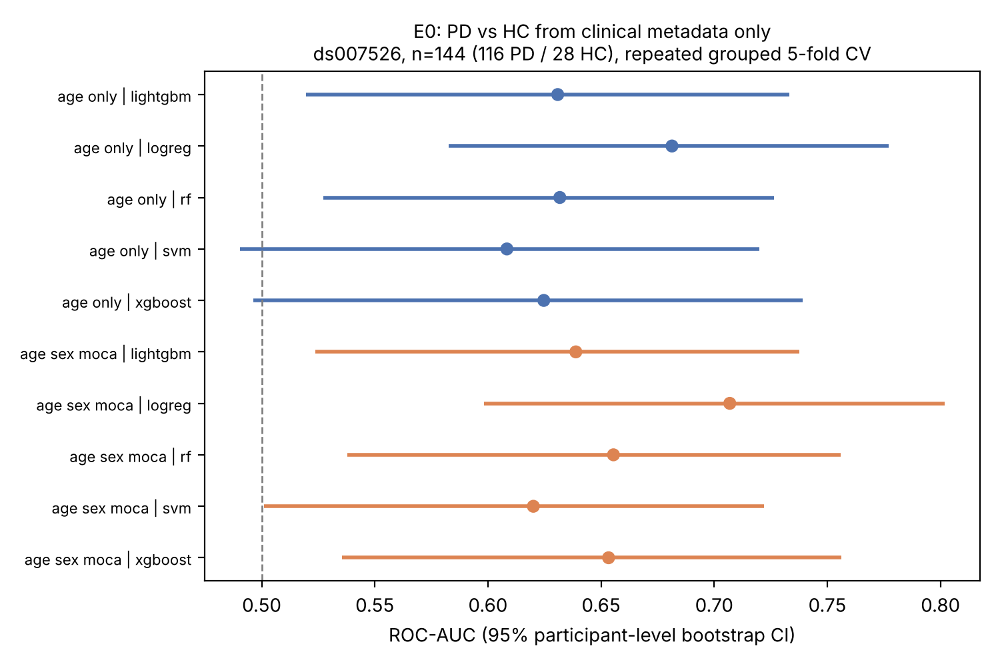
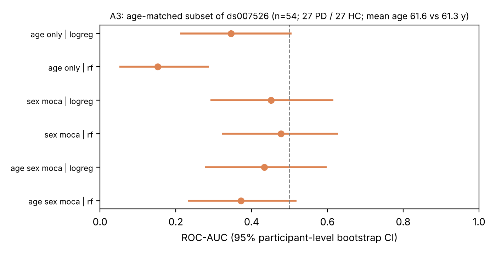

**Status: preprint, not peer reviewed.** Code, data manifests, results and this manuscript: <https://github.com/EkeminiThompson/neurodegenerative-disease-prediction> (commit history is the timestamped record). EEG signals were **not** analysed in this version; see Section 5.

## Abstract

**Background.** Machine-learning studies of neurological disease often report performance from cohorts in which diagnostic groups differ in age or sex, and from evaluation designs that can leak participant information across splits. Baselines that quantify how much of the apparent signal is demographic are rarely reported alongside neural-signal models.

**Methods.** We analysed the public metadata of the open (CC0) OpenNeuro cohort ds007526 (144 participants: 116 Parkinson's disease [PD], 28 healthy controls [HC]; resting and treadmill-walking EEG). Using repeated, stratified, participant-grouped cross-validation with participant-level bootstrap confidence intervals, we trained five classifiers on age, sex and MoCA to separate PD from HC, compared them with paired bootstrap tests, assessed calibration, and repeated the analysis on a 1:1 age-matched subset (n = 54). We also modelled UPDRS part III within PD (n = 113).

**Results.** In the full cohort, age alone reached ROC-AUC 0.61-0.68 and age + sex + MoCA 0.62-0.71 (best: logistic regression 0.707, 95% CI 0.598-0.802). No model differed from another after Holm correction. In the age-matched subset, all clinical feature sets were indistinguishable from chance (all 95% CIs include 0.5; e.g. sex + MoCA, logistic regression, 0.451, 0.291-0.616). Calibration was poor (ECE 0.013-0.253). Within PD, clinical variables reduced UPDRS-III error from 10.2 to 8.3 points.

**Conclusions.** In this cohort the discriminative signal of basic clinical metadata is explained by age and sex imbalance. Any EEG model must therefore be benchmarked against an age-matched baseline rather than against the full-cohort figure. We pre-specify a participant-level, confound-aware protocol for resting and walking EEG and for cross-cohort validation against a second open cohort (ds002778). No claim about EEG performance is made here.

## 1. Introduction

Prediction models built from brain signals are increasingly proposed as markers of neurological disease, but their credibility depends on evaluation design. Information leaking between training and test data inflates performance across many machine-learning-based sciences [2]; cross-validation choices change conclusions in neuroimaging decoding [1]; and best-practice guidance for prediction in psychiatry and neuroscience asks for external validation and explicit confound control [3]. A less discussed but equally basic issue is that diagnostic groups in small open cohorts frequently differ in age and sex, so that a classifier can succeed without using any disease-related neural information.

This paper makes three contributions, none of which is a claim of methodological novelty: (i) a **leakage-safe, confound-aware baseline** for the open Parkinson's EEG cohort ds007526, quantifying how much of the discriminative signal in clinical metadata is demographic; (ii) a documented, tested, open implementation (participant-grouped repeated cross-validation, participant-level bootstrap, paired model comparison, calibration, age-matched sensitivity analysis, nested tuning); and (iii) a **protocol for EEG analyses, fixed before any EEG signal was processed**, covering resting and walking EEG and cross-cohort validation.

## 2. Data

**ds007526** (OpenNeuro v1.0.2, CC0, DOI 10.18112/openneuro.ds007526.v1.0.2; Neurology Institute, Tel Aviv Sourasky Medical Center) [7]. Verified from the dataset's `participants.tsv` (SHA-256 recorded in `data/manifests/ds007526.json`): 144 participants (116 PD, 28 HC); 277 EEG recordings (144 resting, sitting, eyes open, about 4 min; 133 treadmill walking, about 4 min; 65 channels, 250 Hz). Variables: age (144), sex (144), MoCA (140), UPDRS part III (139), UPDRS total (139), disease duration (116, PD only; unit not documented), LEDD (115, PD only). Hoehn & Yahr stage is not in the participant table. PD inclusion criteria were H&Y at most 3 and MoCA at least 21, which restricts severity range. Controls were younger (mean 60.8 vs 66.1 years) and the sex distribution differed (HC 15 F / 13 M; PD 44 F / 72 M).

**ds002778** (OpenNeuro v1.0.5, CC0; UC San Diego) [8]: 31 participants (15 PD, 16 HC), 46 resting recordings (PD recorded on and off medication; 40 channels, 512 Hz). Its maintainers ask to be contacted before manuscripts using the data and caution against machine-learning classification on so few patients; it is therefore designated only as a small external test cohort, to be interpreted with wide intervals (Section 5). It was not used in any result reported here.

No synthetic or simulated participant data are used anywhere in the results. Restricted datasets (PPMI, OASIS-3, ADNI) were not accessed.

## 3. Methods

**Classification features.** Age, sex (F = 0, M = 1) and MoCA. UPDRS, LEDD, disease duration, PIGD and tremor scores were excluded because they are defined only for, or diagnostic of, PD (label leakage). Complete cases: n = 140 (113 PD, 27 HC) for age + sex + MoCA; n = 144 for age alone.

**Models.** Logistic regression, random forest, RBF support vector machine, XGBoost and LightGBM, each in a pipeline of median imputation, standardisation and estimator fitted inside each training fold, with class weighting for the 4:1 imbalance.

**Evaluation.** Stratified group 5-fold cross-validation with participant as group, repeated 20 times (10 for the extended analyses), asserting that no participant appears in both training and test folds. A participant's score is the mean of its out-of-fold predictions across repeats. Confidence intervals are 95% percentile intervals from 2,000 bootstrap resamples of whole participants. Reported metrics: ROC-AUC (primary), PR-AUC, balanced accuracy, sensitivity, specificity, Brier score and expected calibration error (ECE; 10 bins).

**Extended analyses.** *A1:* paired participant-level bootstrap of AUC differences for all 10 model pairs, with Holm correction. *A2:* reliability curves, Brier, ECE. *A3:* every HC was matched 1:1 without replacement to the PD participant nearest in age (caliper 3 years), giving 27 + 27 participants (mean age 61.6 vs 61.3 years); models were then re-evaluated with the same protocol. *A4:* out-of-fold performance by sex. *A5:* nested cross-validation (inner grouped 3-fold grid search of logistic regression C and random-forest leaf size and depth inside each outer fold; 3 repeats). **Severity (E1):** ridge and random-forest regression of UPDRS part III on age, sex, MoCA, disease duration and LEDD within PD (n = 113), against a training-mean baseline; MAE and Spearman correlation.

**Order of analyses (transparency).** E0 and E1 were specified and run first. A1-A5 were added *after* seeing E0 and are therefore **exploratory**. The EEG protocol (Section 5) was committed (commit `0752220`, 8 November 2026) before any EEG file was processed; its age-matched requirement was added after A3.

## 4. Results

{ width=78% }

**Full cohort (E0).** Age alone: logistic regression 0.681 (0.583-0.777), random forest 0.632 (0.527-0.726), SVM 0.608 (0.490-0.720), XGBoost 0.625 (0.496-0.739), LightGBM 0.631 (0.520-0.733). Age + sex + MoCA: 0.707 (0.598-0.802), 0.655 (0.538-0.756), 0.620 (0.501-0.722), 0.653 (0.536-0.756), 0.639 (0.524-0.738), respectively. Adding sex and MoCA changed AUC by at most 0.03 and the intervals overlap throughout.

**Model comparison (A1).** No pair of models differed after Holm correction (smallest raw bootstrap p = 0.095, logistic regression vs SVM; all Holm-adjusted p $\geq$ 0.95). Model choice is not a meaningful source of variation on three clinical features.

**Age-matched subset (A3).** With age balanced, no clinical feature set separated PD from HC above chance:

| Features (logistic regression) | ROC-AUC | 95% CI |
|---|---|---|
| Age only | 0.346 | 0.212-0.505 |
| Sex + MoCA | 0.451 | 0.291-0.616 |
| Age + sex + MoCA | 0.433 | 0.276-0.598 |

{ width=78% }

Random forest gave 0.152 (0.051-0.288) for age alone, 0.477 (0.321-0.628) for sex + MoCA and 0.372 (0.232-0.519) for all three. Point estimates below 0.5 are a known artefact of cross-validating pure noise in very small balanced samples (training folds carry chance imbalances that reverse in the held-out fold); they are not evidence of an inverse relationship and we do not interpret them. The finding is that the intervals contain 0.5 (or, for random forest on age alone, lie below it), i.e. there is no demonstrated age-independent signal. With 54 participants the intervals are wide (for example 0.29-0.62 for sex + MoCA), so a modest true effect cannot be excluded; the result says that *the full-cohort AUC of about 0.7 is not evidence of disease-related information*, not that none exists.

**Calibration (A2).** ECE ranged from 0.013 (SVM) to 0.253 (logistic regression); Brier scores 0.151-0.217. The SVM's low ECE reflects predictions close to the 81% PD prior for nearly everyone (specificity 0 at threshold 0.5 in E0), not discrimination. None of these models yields interpretable risks.

**Sex subgroups (A4, exploratory).** Apparent discrimination was concentrated in women (logistic regression 0.756, 0.612-0.875; 15 HC) and absent in men (0.600, 0.439-0.772; 12 HC); tree models were at or below chance in men (e.g. random forest 0.481, 0.301-0.660). With 12-15 controls per sex this is hypothesis-generating only.

**Nested tuning (A5).** Logistic regression 0.681 (0.565-0.783) and random forest 0.705 (0.596-0.803), n = 140; tuning did not change the conclusions.

**Severity within PD (E1).** Training-mean baseline MAE 10.16 points (8.81-11.57); ridge 8.26 (6.93-9.69; Spearman 0.463); random forest 8.60 (7.29-9.94; Spearman 0.456). The improvement is about 2 UPDRS points with overlapping intervals. Disease-duration units are undocumented, and the narrow H&Y range limits generalisation.

## 5. Pre-specified protocol for EEG (not yet executed)

**Data processing.** One fixed pipeline for all cohorts (MNE-Python [4], BIDS [5,6]): 1-45 Hz zero-phase FIR band-pass, mains notch, resampling to 250 Hz, common-average reference, 4 s non-overlapping windows, amplitude rejection. Features: relative and absolute band powers (delta 1-4, theta 4-8, alpha 8-13, beta 13-30, gamma 30-45 Hz), spectral entropy, peak alpha frequency, Hjorth parameters, ratios; window values are collapsed to one vector per recording by the median, aggregated to global and 10-20 region level so that cohorts with different montages are comparable. Splitting is always by participant.

**Hypotheses and decision rules.**

- **H1 (within cohort, resting EEG, ds007526).** Region-level resting EEG features discriminate PD from HC *in the age-matched subset* with a lower 95% CI bound above 0.5. Not supported otherwise, regardless of full-cohort AUC.
- **H2 (external validation).** Models trained on one cohort and tested on the other (ds007526 and ds002778 in both directions) retain AUC above 0.5 with lower bound above 0.5; we report the internal-to-external AUC drop, calibration, a domain-classifier AUC (cohort separability from features alone), and standardized mean differences before any label is used. If the domain-classifier AUC is at least 0.9, external results are interpreted as domain shift first.
- **H3 (state dependence, ds007526).** Walking-EEG features differ from resting-EEG features within participants (paired contrast of region-level band powers), and walking features add discriminative information beyond resting features. Because gait produces movement artefacts, H3 requires a stricter artefact-handling sensitivity analysis than the default amplitude threshold; the current pipeline is **not validated for walking EEG**.

Secondary: clinical + EEG fusion, SHAP attribution on the best pre-specified model, ON versus OFF medication in ds002778 (descriptive, n = 15). Negative results will be reported. Implementation: `scripts/extract_eeg_features.py`, `scripts/run_eeg_experiments.py`, `scripts/run_external_validation.py`.

## 6. Discussion

**What the evidence supports.** In this open cohort, basic clinical metadata separates PD from HC only to the extent that age and sex differ between groups. That is a modest, specific, reproducible finding. Its practical consequence is a benchmark: EEG (or imaging) models should be reported with an age-matched analysis and an external cohort, and full-cohort AUCs near 0.7 from three demographic variables show how easily such a benchmark can be reached without neural data.

**Relevance to the computational study of movement-related neural signals.** The cohort pairs the same participants at rest and during treadmill walking, which makes it a practical testbed for questions about how neural signals change with movement and for modelling approaches that must separate movement-related from group-related variance. The framework here is deliberately modality-agnostic: participant-level inference, explicit nuisance-variable control, preregistered contrasts and open code transfer directly to psychophysical and neural data from movement-perception experiments. This paper does not itself analyse movement perception or conscious experience, and it contains no psychophysical or EEG results; it provides the evaluation discipline on which such analyses would rest.

**Limitations.** Single site, single visit, no external test of the clinical results; small and imbalanced groups (27-28 HC); exploratory status of A1-A5; undocumented disease-duration units and medication state at assessment; narrow severity range; sex-subgroup estimates based on few controls; no EEG results. The negative-looking age-matched estimates have wide intervals and low power. Models are research baselines and are not clinically validated.

## 7. Data and code availability

All code, manifests (dataset versions, mirror commit hashes, checksums), configuration, results tables, figures and a JSONL run log are in the repository. Reproduction: `python scripts/fetch_metadata.py`, `python scripts/run_clinical_baseline.py --repeats 20`, `python scripts/run_clinical_extended.py --repeats 10`, `python scripts/make_figures.py`. Seed 20261108. Continuous integration runs the unit tests and linting (toy fixtures only; never used as evidence).

## References

1. Varoquaux G, Raamana PR, Engemann DA, Hoyos-Idrobo A, Schwartz Y, Thirion B. Assessing and tuning brain decoders: cross-validation, caveats, and guidelines. *NeuroImage* 2017;145:166-179. doi:10.1016/j.neuroimage.2016.10.038
2. Kapoor S, Narayanan A. Leakage and the reproducibility crisis in machine-learning-based science. *Patterns* 2023;4(9):100804. doi:10.1016/j.patter.2023.100804
3. Poldrack RA, Huckins G, Varoquaux G. Establishment of best practices for evidence for prediction: a review. *JAMA Psychiatry* 2020;77(5):534-540. doi:10.1001/jamapsychiatry.2019.3671
4. Gramfort A, Luessi M, Larson E, et al. MEG and EEG data analysis with MNE-Python. *Front Neurosci* 2013;7:267. doi:10.3389/fnins.2013.00267
5. Appelhoff S, Sanderson M, Brooks T, et al. MNE-BIDS: organizing electrophysiological data into the BIDS format and facilitating their analysis. *J Open Source Softw* 2019;4(44):1896. doi:10.21105/joss.01896
6. Pernet CR, Appelhoff S, Gorgolewski KJ, et al. EEG-BIDS, an extension to the brain imaging data structure for electroencephalography. *Sci Data* 2019;6:103. doi:10.1038/s41597-019-0104-8
7. Katzir Z, Vered D, Maidan I. PD-EEG: resting-state and walking EEG in Parkinson's disease. OpenNeuro ds007526 v1.0.2. doi:10.18112/openneuro.ds007526.v1.0.2. (Related article listed in the dataset description: "Electroencephalography-Based Clustering Reveals Robust Neurophysiological Subtypes in Parkinson's Disease", doi:10.1002/mds.70348.)
8. Rockhill AP, Jackson N, George J, Aron A, Swann NC. UC San Diego resting state EEG data from patients with Parkinson's disease. OpenNeuro ds002778 v1.0.5. doi:10.18112/openneuro.ds002778.v1.0.5. See also Jackson N, et al. *eNeuro* 2019;6(3):ENEURO.0151-19.2019; Swann NC, et al. *Ann Neurol* 2015;78(5):742-750; George JS, et al. *NeuroImage Clin* 2013;3:261-270.
9. Holm S. A simple sequentially rejective multiple test procedure. *Scand J Stat* 1979;6:65-70.
10. Pedregosa F, Varoquaux G, Gramfort A, et al. Scikit-learn: machine learning in Python. *J Mach Learn Res* 2011;12:2825-2830.
