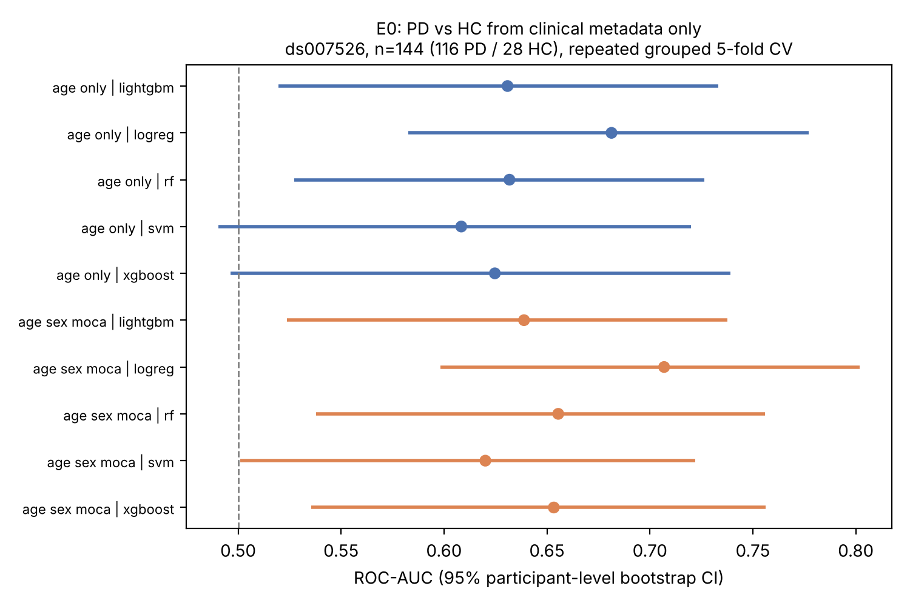
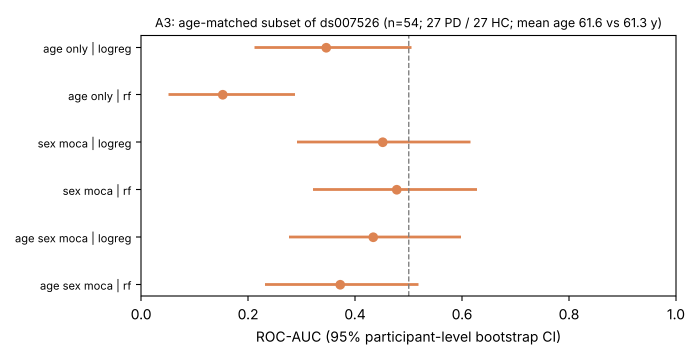

Code, data manifests, results tables and figures: <https://github.com/EkeminiThompson/neurodegenerative-disease-prediction>. All results use the public participant-level tables of OpenNeuro dataset ds007526.

## Abstract

**Background.** Machine-learning studies of neurological disease often report performance from cohorts in which diagnostic groups differ in age, and from evaluation designs that can leak participant information across splits. Baselines that show how much of an apparent signal is demographic are rarely reported.

**Methods.** We analysed the open (CC0) cohort ds007526 (144 participants: 116 Parkinson's disease [PD], 28 healthy controls [HC]). With repeated, stratified, participant-grouped cross-validation and participant-level bootstrap confidence intervals, we trained five classifiers on age, sex and MoCA to separate PD from HC, compared them with paired bootstrap tests, assessed calibration, and repeated the analysis on a 1:1 age-matched subset (n = 54). We also modelled UPDRS part III within PD (n = 113).

**Results.** In the full cohort, age alone reached ROC-AUC 0.61-0.68 and age + sex + MoCA 0.62-0.71 (best: logistic regression 0.707, 95% CI 0.598-0.802). No model differed from another after Holm correction. In the age-matched subset, every clinical feature set was indistinguishable from chance (all 95% CIs include 0.5 or lie below it; e.g. sex + MoCA, logistic regression, 0.451, 0.291-0.616). Calibration was poor (expected calibration error 0.013-0.253). Within PD, clinical variables reduced UPDRS-III error from 10.2 to 8.3 points.

**Conclusions.** In this cohort the discriminative value of basic clinical metadata is explained by the age imbalance between groups. Any model for this cohort should be benchmarked against an age-matched baseline rather than against the full-cohort figure.

## 1. Introduction

Prediction models for neurological disease are increasingly proposed as markers of diagnosis, but their credibility depends on evaluation design. Information leaking between training and test data inflates performance across many machine-learning-based sciences [2]; cross-validation choices change conclusions in neuroimaging decoding [1]; and best-practice guidance for prediction in psychiatry and neuroscience asks for external validation and explicit confound control [3]. A less discussed but equally basic issue is that diagnostic groups in small open cohorts frequently differ in age, so that a classifier can succeed without using any disease-related information.

This paper provides (i) a **leakage-safe, confound-aware baseline** for the open Parkinson's cohort ds007526, quantifying how much of the discriminative value of clinical metadata is demographic, and (ii) a documented, unit-tested, open implementation: participant-grouped repeated cross-validation, participant-level bootstrap, paired model comparison, calibration, age-matched sensitivity analysis and nested tuning. We do not claim methodological novelty for the individual components.

## 2. Data

**ds007526** (OpenNeuro v1.0.2, CC0, DOI 10.18112/openneuro.ds007526.v1.0.2; Neurology Institute, Tel Aviv Sourasky Medical Center) [4]. Verified from the dataset's `participants.tsv` (SHA-256 and mirror commit in `data/manifests/ds007526.json`): 144 participants (116 PD, 28 HC). Participant-table variables and non-missing counts: age (144), sex (144), MoCA (140), UPDRS part III (139), UPDRS total (139), disease duration (116, PD only; months), levodopa equivalent daily dose (LEDD; 115, PD only). Inclusion criteria for PD were Hoehn & Yahr stage at most 3 and MoCA at least 21, which limits severity range. Healthy controls were younger than patients (mean 60.8, SD 7.5 vs 66.1, SD 9.4 years; difference 5.3 years, Welch p = 0.002); the proportion of women was 54% in HC and 38% in PD (Fisher p = 0.14).

## 3. Methods

**Classification features.** Age, sex (F = 0, M = 1) and MoCA. UPDRS, LEDD, disease duration, PIGD and tremor scores were excluded because they are defined only for, or diagnostic of, PD (label leakage). Complete cases: n = 140 (113 PD, 27 HC) for age + sex + MoCA; n = 144 for age alone.

**Models.** Logistic regression, random forest, RBF support vector machine, XGBoost and LightGBM [6], each in a pipeline of median imputation, standardisation and estimator fitted inside each training fold, with class weighting for the 4:1 imbalance.

**Evaluation.** Stratified group 5-fold cross-validation with participant as group, repeated 20 times (10 for the extended analyses), with an assertion that no participant appears in both training and test folds. A participant's score is the mean of its out-of-fold predictions across repeats. Confidence intervals are 95% percentile intervals from 2,000 bootstrap resamples of whole participants. Metrics: ROC-AUC (primary), PR-AUC, balanced accuracy, sensitivity, specificity, Brier score and expected calibration error (ECE; 10 bins).

**Extended analyses.** *A1:* paired participant-level bootstrap of AUC differences for all 10 model pairs, with Holm correction [5]. *A2:* reliability curves, Brier score, ECE. *A3:* every HC was matched 1:1 without replacement to the PD participant nearest in age (caliper 3 years), giving 27 + 27 participants (mean age 61.6 vs 61.3 years); models were re-evaluated with the same protocol. *A4:* out-of-fold performance by sex. *A5:* nested cross-validation (inner grouped 3-fold grid search of logistic regression C and random-forest leaf size and depth inside each outer fold; 3 repeats). **Severity (E1):** ridge and random-forest regression of UPDRS part III on age, sex, MoCA, disease duration and LEDD within PD (n = 113), against a training-mean baseline; MAE and Spearman correlation.

**Order of analyses.** E0 (classification) and E1 (severity) were specified and run first. A1-A5 were added after seeing E0 and are therefore exploratory. Seed 20261108; every run appends its configuration and metrics to `reports/results/runs.jsonl`.

## 4. Results

{ width=78% }

**Full cohort (E0).** Age alone: logistic regression 0.681 (0.583-0.777), random forest 0.632 (0.527-0.726), SVM 0.608 (0.490-0.720), XGBoost 0.625 (0.496-0.739), LightGBM 0.631 (0.520-0.733). Age + sex + MoCA: 0.707 (0.598-0.802), 0.655 (0.538-0.756), 0.620 (0.501-0.722), 0.653 (0.536-0.756), 0.639 (0.524-0.738), respectively. Adding sex and MoCA changed AUC by at most 0.03 and the intervals overlap throughout.

**Model comparison (A1).** No pair of models differed after Holm correction (smallest raw bootstrap p = 0.095, logistic regression vs SVM; all Holm-adjusted p $\geq$ 0.95). Model choice is not a meaningful source of variation on three clinical features.

**Age-matched subset (A3).** With age balanced, no clinical feature set separated PD from HC above chance:

| Features (logistic regression) | ROC-AUC | 95% CI |
|---|---|---|
| Age only | 0.346 | 0.212-0.505 |
| Sex + MoCA | 0.451 | 0.291-0.616 |
| Age + sex + MoCA | 0.433 | 0.276-0.598 |

{ width=78% }

Random forest gave 0.152 (0.051-0.288) for age alone, 0.477 (0.321-0.628) for sex + MoCA and 0.372 (0.232-0.519) for all three. Point estimates below 0.5 are a known artefact of cross-validating noise in very small balanced samples (training folds carry chance imbalances that reverse in the held-out fold); they are not evidence of an inverse relationship and are not interpreted. With 54 participants the intervals are wide (for example 0.29-0.62 for sex + MoCA), so a modest true effect cannot be excluded. The result is that *the full-cohort AUC of about 0.7 is not evidence of disease-related information*.

**Calibration (A2).** ECE ranged from 0.013 (SVM) to 0.253 (logistic regression); Brier scores 0.151-0.217. The SVM's low ECE reflects predictions close to the 81% PD prior for nearly everyone (specificity 0 at threshold 0.5 in E0), not discrimination. None of these models yields interpretable risks.

**Sex subgroups (A4, exploratory).** Apparent discrimination was concentrated in women (logistic regression 0.756, 0.612-0.875; 15 HC) and absent in men (0.600, 0.439-0.772; 12 HC); tree models were at or below chance in men (e.g. random forest 0.481, 0.301-0.660). With 12-15 controls per sex this is hypothesis-generating only.

**Nested tuning (A5).** Logistic regression 0.681 (0.565-0.783) and random forest 0.705 (0.596-0.803), n = 140; tuning did not change the conclusions.

**Severity within PD (E1).** Training-mean baseline MAE 10.16 points (8.81-11.57); ridge 8.26 (6.93-9.69; Spearman 0.463); random forest 8.60 (7.29-9.94; Spearman 0.456). The improvement is about 2 UPDRS points with overlapping intervals.

## 5. Discussion

**What the evidence supports.** In this open cohort, basic clinical metadata separates PD from HC only to the extent that age differs between groups: the full-cohort AUC of 0.61-0.71 collapses to chance once age is balanced. The finding is modest, specific and reproducible from the released code. Its practical consequence is a benchmark: models for this cohort should be reported with an age-matched analysis, and full-cohort AUCs near 0.7 from three demographic variables show how easily such a figure can be reached without any disease-related information.

**Evaluation lessons.** Three results transfer beyond this cohort: model choice was irrelevant on low-dimensional inputs (no pair differed), nested tuning did not alter the conclusions, and threshold-based metrics and calibration were unstable at an 81% prevalence, so AUC with participant-level intervals was the only stable summary.

**Limitations.** One cohort from one site, so all estimates are within-cohort; small control group (27-28 HC) and imbalanced classes; A1-A5 are exploratory; the age-matched analysis has low power and wide intervals; unknown medication state at assessment; narrow severity range (Hoehn & Yahr at most 3, MoCA at least 21); sex-subgroup estimates rest on 12-15 controls. The models are research baselines, not clinically validated tools.

## 6. Data and code availability

All code, manifests (dataset version, mirror commit, checksum), configuration, result tables, figures and a JSONL run log are in the repository. Reproduction: `python scripts/fetch_metadata.py`, `python scripts/run_clinical_baseline.py --repeats 20`, `python scripts/run_clinical_extended.py --repeats 10`, `python scripts/make_figures.py`. Continuous integration runs the unit tests and linting on hand-built fixtures only.

## References

1. Varoquaux G, Raamana PR, Engemann DA, Hoyos-Idrobo A, Schwartz Y, Thirion B. Assessing and tuning brain decoders: cross-validation, caveats, and guidelines. *NeuroImage* 2017;145:166-179. doi:10.1016/j.neuroimage.2016.10.038
2. Kapoor S, Narayanan A. Leakage and the reproducibility crisis in machine-learning-based science. *Patterns* 2023;4(9):100804. doi:10.1016/j.patter.2023.100804
3. Poldrack RA, Huckins G, Varoquaux G. Establishment of best practices for evidence for prediction: a review. *JAMA Psychiatry* 2020;77(5):534-540. doi:10.1001/jamapsychiatry.2019.3671
4. Katzir Z, Vered D, Maidan I. PD-EEG: resting-state and walking EEG in Parkinson's disease. OpenNeuro ds007526 v1.0.2. doi:10.18112/openneuro.ds007526.v1.0.2. (Related article listed in the dataset description: "Electroencephalography-Based Clustering Reveals Robust Neurophysiological Subtypes in Parkinson's Disease", doi:10.1002/mds.70348.)
5. Holm S. A simple sequentially rejective multiple test procedure. *Scand J Stat* 1979;6:65-70.
6. Pedregosa F, Varoquaux G, Gramfort A, et al. Scikit-learn: machine learning in Python. *J Mach Learn Res* 2011;12:2825-2830. (XGBoost and LightGBM were used through their scikit-learn-compatible interfaces.)
