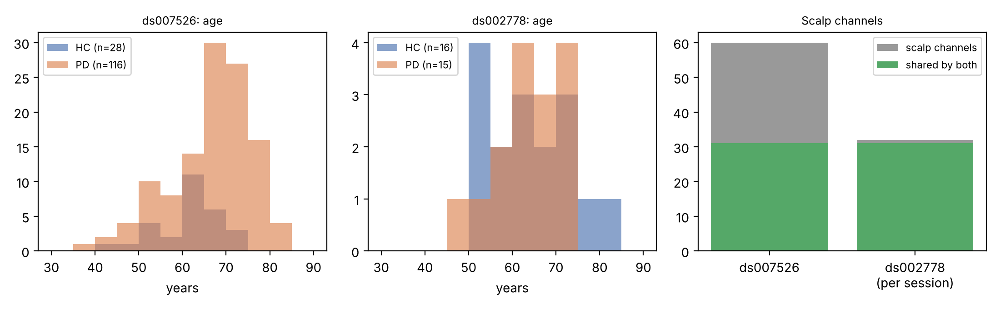

**Status: preprint, not peer reviewed.** Audit scripts, tables, checksums and loaders: <https://github.com/EkeminiThompson/neurodegenerative-disease-prediction>.

## Abstract

**Background.** Open EEG cohorts of Parkinson's disease (PD) are increasingly reused, but their documentation is spread across dataset pages, BIDS sidecars and side files, and details that matter for analysis (group balance, channel typing, sidecar consistency, supplementary clinical files, stewardship conditions) are easy to miss.

**Methods.** We audited OpenNeuro ds007526 (Tel Aviv Sourasky Medical Center; resting and walking EEG) and ds002778 (UC San Diego; resting EEG, on and off medication) directly from their BIDS metadata, sidecars, channel tables, behavioural files and dataset pages. Every count was recomputed from source files with released scripts, and each `participants.tsv` was recorded with its SHA-256 and mirror commit.

**Results.** ds007526 contains 144 participants (116 PD, 28 healthy controls [HC]) and 277 recordings (144 resting, 133 walking); ds002778 contains 31 participants (15 PD, 16 HC) and 46 resting recordings (16 HC, 15 PD on, 15 PD off medication). Groups differ in age in ds007526 (PD 5.3 years older, p = 0.002) but not in ds002778 (difference 0.2 years, p = 0.94). Acquisition differs in system (EGI vs BioSemi), sampling rate (250 vs 512 Hz), channels (60 vs 32 scalp channels, 31 shared) and severity measures (UPDRS vs Hoehn & Yahr, which has only two levels in ds002778). Both cohorts type non-scalp channels as EEG (EOG1-4 and VREF; EXG1-8 and Status). ds007526 additionally ships item-level UPDRS for 117 PD rows and follow-up data for 39 PD participants (mean interval 2.2 years). We document further data-quality notes and the access and stewardship conditions of both datasets.

**Conclusions.** The two cohorts differ in composition, acquisition and metadata in ways that affect any analysis that combines or compares them. The released audit tables, harmonisation rules and checksums make these properties verifiable and reusable.

## 1. Introduction

Open datasets are the main route by which small research groups can study neurophysiology in Parkinson's disease, but each reuse begins with the same costly step: working out what a dataset really contains. Dataset pages report headline counts, while the facts that determine whether an analysis is valid sit elsewhere: in per-recording sidecars, channel tables, behavioural files, side directories and the discussion threads of the dataset page. Errors at this stage (using non-scalp channels as EEG, mis-coding groups, comparing cohorts with different age structure) propagate into results.

We provide a verified audit of two openly licensed PD EEG cohorts, ds007526 [1] and ds002778 [2], with every number reproducible from released scripts.

## 2. Methods

**Sources.** ds007526 v1.0.2 (CC0; DOI 10.18112/openneuro.ds007526.v1.0.2; metadata mirror commit `3644d723a5`; `participants.tsv` SHA-256 prefix `f6dc5ddcfc55999e`) and ds002778 v1.0.5 (CC0; DOI 10.18112/openneuro.ds002778.v1.0.5; mirror commit `2890cbd8da`; SHA-256 prefix `e26c2cd97197a851`). Both are organised in BIDS [7]. Metadata, sidecars, channel tables, behavioural files and `sourcedata/` were obtained from the OpenNeuro GitHub mirrors; dataset-page text (README, file counts, version history, comments) was read from the OpenNeuro pages.

**Procedure.** Participant counts come from `participants.tsv`; recordings were counted and characterised from the `*_eeg.json` sidecars (sampling rate, mains frequency, channel count, duration) and `*_channels.tsv`. Group labels: from the `group` column in ds007526, and from the participant-ID prefix (`sub-hc`, `sub-pd`) in ds002778, whose README names the groups. Missing values (`n/a`) are kept missing; no label or value is inferred. Sex is coded F = 0, M = 1. Age differences were tested with Welch's t-test and sex proportions with Fisher's exact test; paired on-off differences in ds002778 use a participant-level bootstrap (5,000 resamples). Scripts: `scripts/audit_metadata.py`, `scripts/audit_tables.py`, `scripts/longitudinal_descriptives.py`; loaders and unit tests in `src/ndpred/data/bids.py` and `tests/`.

## 3. Results

{ width=95% }

### 3.1 Composition

| Cohort | Group | n | Age, mean (SD) | Women | Cognitive screen, mean (SD) | PD severity (mean, SD) |
|---|---|---|---|---|---|---|
| ds007526 | HC | 28 | 60.8 (7.5) | 15 (54%) | MoCA 27.4 (2.0) | |
| ds007526 | PD | 116 | 66.1 (9.4) | 44 (38%) | MoCA 25.2 (3.1) | UPDRS III 24.8 (12.5); UPDRS total 40.3 (20.5) |
| ds002778 | HC | 16 | 63.5 (9.7) | 9 (56%) | MMSE 29.2 (1.1) | |
| ds002778 | PD | 15 | 63.3 (8.2) | 8 (53%) | MMSE 28.9 (1.0) | see Section 3.5 |

In ds007526, PD participants were 5.3 years older than HC (Welch t = -3.20, p = 0.002) and the proportion of women was 54% in HC vs 38% in PD (Fisher p = 0.14). In ds002778 the groups did not differ in age (difference -0.2 years, p = 0.94) or sex (p = 1.0). The cohorts therefore differ in whether age is balanced between groups. PD inclusion criteria in ds007526 were Hoehn & Yahr stage at most 3 and MoCA at least 21 [10, 11]; mean LEDD was 421 mg/day (SD 384) [13].

### 3.2 Recordings and acquisition

| Cohort | Task | Recordings (HC / PD) | System, sampling | Mains in sidecars | Duration, s (mean; min-max) |
|---|---|---|---|---|---|
| ds007526 | rest, sitting, eyes open | 144 (28 / 116) | EGI Geodesic 400; 250 Hz | 50 Hz (all) | 242 (241-245) |
| ds007526 | walk, treadmill | 133 (23 / 110) | same | 50 Hz (all) | 265 (241-2,167) |
| ds002778 | rest | 46 (16 / 30*) | BioSemi; 512 Hz | 60 Hz (37); 50 Hz (9) | 197 (181-292) |

*15 PD participants recorded both on and off medication (30 PD sessions). Eleven ds007526 participants (5 HC, 6 PD) have no walking recording.

### 3.3 Variable availability

ds007526 (n = 144): age 144, sex 144, MoCA 140, UPDRS part III 139, UPDRS total 139, disease duration 116 (PD only), LEDD 115 (PD only). ds002778 (n = 31): age 31, sex 31, MMSE 31, NAART 31, disease duration 15 (PD only; in years, mean 4.5, SD 3.5). Hoehn & Yahr is absent from ds007526 (including its item-level file); UPDRS and Hoehn & Yahr for ds002778 are stored per session in behavioural sidecars rather than in `participants.tsv`. Disease duration is documented in months in ds007526 (PD mean 58.6, SD 47.1) and in years in ds002778 (mean 4.5, SD 3.5), both in `participants.json`.

### 3.4 Channels

Both cohorts type non-scalp channels as EEG in `channels.tsv`: ds007526 lists 65 rows, of which EOG1-4 and VREF (a vertex reference channel) are non-scalp, leaving 60 scalp channels; ds002778 lists 41 rows, of which EXG1-8 (eye and mastoid channels) and Status (trigger) are non-scalp, leaving 32. Software that selects channels by declared type will therefore include these channels in re-referencing and in channel-averaged features. The two scalp montages share 31 channels (Fp1, AF3, F7, F3, FC1, FC5, T7, C3, CP1, CP5, P7, P3, Pz, PO3, O1, Oz, O2, PO4, P4, P8, CP6, CP2, C4, T8, FC6, FC2, F4, F8, AF4, Fp2, Fz); ds002778 additionally has Cz, which ds007526 does not list (it lists a vertex reference, VREF, instead).

### 3.5 Severity and medication state

*ds007526:* UPDRS part III and total are in the participant table for PD (mean 24.8 and 40.3). *ds002778:* total UPDRS and Hoehn & Yahr are available for each of the 30 PD sessions. Hoehn & Yahr has two levels only (stage 2: 8 off and 7 on sessions; stage 3: 7 off and 8 on), and is identical on and off medication in 12 of 15 participants (mean off 2.47, on 2.53). Total UPDRS was higher off than on medication by 6.5 points (95% bootstrap CI 3.4-9.7; mean 39.2 off vs 32.7 on; n = 15 pairs; identical in 2 pairs). The dataset README notes that UPDRS was rated by trained laboratory personnel rather than a board-certified neurologist.

### 3.6 Supplementary clinical files in ds007526

`sourcedata/clinical_data/full_UPDRS_data.tsv` holds item-level MDS-UPDRS (parts 1-4) [9] for 117 PD rows, 115 of which map to `participants.tsv` through `subject_id`. Gait-related part III items (PD participants with data): gait (3.10) mean 0.92 (n = 113; 74% scored at least 1), freezing of gait (3.11) mean 0.07 (7%), postural stability (3.12) mean 0.50 (n = 112; 34%), posture (3.13) mean 1.05 (71%). `longitudinal_clinical_data.tsv` holds follow-up data for 39 PD participants, all matched: mean interval 2.16 years (range 0.4-5.65). Mean change from the baseline values in `participants.tsv`: UPDRS part III +1.7 points (95% CI -2.3 to 5.8; n = 38), UPDRS total +5.1 (-0.9 to 11.1; n = 38), MoCA -0.3 (-1.1 to 0.4; n = 38), LEDD -139 mg/day (-292 to 23; n = 39). Medication state at either assessment is not documented, so these are descriptive.

### 3.7 Data-quality notes

1. **Sidecar mains frequency (ds002778).** 9 of 46 sidecars (5 HC, 4 PD on-medication) list 50 Hz and 37 list 60 Hz, although the dataset describes a single laboratory; the field is internally inconsistent.
2. **Recording length (ds007526).** Four walking recordings exceed 5 minutes (2,167 s, 907 s, 483 s and 453 s) against a typical 241-265 s.
3. **Processed files (ds002778).** The maintainers state that the data are not preprocessed except pd6 and pd16 on-medication, which were low-pass filtered because the raw files were lost; they also note a persistent single-channel (P8) artefact in subject pd17 and a CMS/DRL reference; education was not collected.
4. **Validation (ds007526).** The dataset passes BIDS validation with 5,430 warnings (dataset page).
5. **Group coding.** Groups are an explicit column in ds007526 but are encoded only in the participant ID in ds002778.

### 3.8 Access, licensing and stewardship

Both datasets are CC0 and downloadable without application (ds007526: 1,823 files, 4.26 GB; ds002778: 328 files, 545 MB). The ds007526 page states "Please contact the authors" under how to acknowledge, and its authors have published an EEG-based clustering analysis of the cohort [3]. The ds002778 maintainers ask to be emailed before a manuscript using the data is submitted, request citation of three papers [4-6] and MNE-BIDS [8] and EEG-BIDS [7], and state that, with 15 patients, any train-test split would leave fewer than 8 patients in the test set, which they consider too few for machine-learning classification of PD against healthy controls.

## 4. Discussion

**Why these differences matter.** A model or statistic that compares groups behaves differently in the two cohorts for reasons unrelated to disease: age is confounded with diagnosis in ds007526 but balanced in ds002778; severity is a continuous UPDRS in one and a two-level Hoehn & Yahr in the other; one cohort has walking recordings and the other has medication contrasts. Combining or comparing the cohorts without accounting for these properties would attribute cohort differences to disease.

**Practical recommendations that follow from the audit.** (i) Exclude non-scalp channels before re-referencing; use the 31 shared channels (and not Cz) when features must be comparable across cohorts. (ii) Report group-balance statistics, and an age-matched analysis for ds007526. (iii) Take group labels from the documented sources listed in Section 2 and keep missing clinical values missing. (iv) Do not rely on `PowerLineFrequency` in ds002778 sidecars. (v) Check recording durations before windowing walking data in ds007526. (vi) Respect the contact requests of both data owners.

**Limitations.** The audit is based on metadata, sidecars, channel tables, behavioural and side files and dataset-page text; recording counts and durations are taken from sidecars. Medication state at assessment is not documented for the ds007526 clinical, item-level and follow-up files. Follow-up and on-off results are descriptive and small (n = 39 and n = 15). Counts and variables refer to the stated dataset versions and may change in later versions.

## 5. Data and code availability

Reproduce every table with `python scripts/fetch_metadata.py`, `python scripts/audit_metadata.py`, `python scripts/audit_tables.py` and `python scripts/longitudinal_descriptives.py` (outputs: `data/manifests/*.json`, `reports/tables/audit_*.csv`, `reports/tables/longitudinal_descriptives_ds007526.csv`). The data themselves are available from OpenNeuro under CC0; no participant-level data are redistributed in the repository.

## References

1. Katzir Z, Vered D, Maidan I. PD-EEG: resting-state and walking EEG in Parkinson's disease. OpenNeuro ds007526 v1.0.2. doi:10.18112/openneuro.ds007526.v1.0.2
2. Rockhill AP, Jackson N, George J, Aron A, Swann NC. UC San Diego resting state EEG data from patients with Parkinson's disease. OpenNeuro ds002778 v1.0.5. doi:10.18112/openneuro.ds002778.v1.0.5
3. "Electroencephalography-Based Clustering Reveals Robust Neurophysiological Subtypes in Parkinson's Disease", listed in the ds007526 dataset description. doi:10.1002/mds.70348
4. Jackson N, Cole SR, Voytek B, Swann NC. Characteristics of waveform shape in Parkinson's disease detected with scalp electroencephalography. *eNeuro* 2019;6(3):ENEURO.0151-19.2019. doi:10.1523/ENEURO.0151-19.2019
5. Swann NC, de Hemptinne C, Aron AR, Ostrem JL, Knight RT, Starr PA. Elevated synchrony in Parkinson disease detected with electroencephalography. *Ann Neurol* 2015;78(5):742-750. doi:10.1002/ana.24507
6. George JS, Strunk J, Mak-McCully R, Houser M, Poizner H, Aron AR. Dopaminergic therapy in Parkinson's disease decreases cortical beta band coherence in the resting state and increases cortical beta band power during executive control. *NeuroImage Clin* 2013;3:261-270. doi:10.1016/j.nicl.2013.07.013
7. Pernet CR, Appelhoff S, Gorgolewski KJ, et al. EEG-BIDS, an extension to the brain imaging data structure for electroencephalography. *Sci Data* 2019;6:103. doi:10.1038/s41597-019-0104-8
8. Appelhoff S, Sanderson M, Brooks T, et al. MNE-BIDS: organizing electrophysiological data into the BIDS format and facilitating their analysis. *J Open Source Softw* 2019;4(44):1896. doi:10.21105/joss.01896
9. Goetz CG, Tilley BC, Shaftman SR, et al. Movement Disorder Society-sponsored revision of the Unified Parkinson's Disease Rating Scale (MDS-UPDRS). *Mov Disord* 2008;23(15):2129-2170. doi:10.1002/mds.22340
10. Hoehn MM, Yahr MD. Parkinsonism: onset, progression and mortality. *Neurology* 1967;17(5):427-442. doi:10.1212/WNL.17.5.427
11. Nasreddine ZS, Phillips NA, Bedirian V, et al. The Montreal Cognitive Assessment, MoCA: a brief screening tool for mild cognitive impairment. *J Am Geriatr Soc* 2005;53(4):695-699. doi:10.1111/j.1532-5415.2005.53221.x
12. Folstein MF, Folstein SE, McHugh PR. "Mini-mental state": a practical method for grading the cognitive state of patients for the clinician. *J Psychiatr Res* 1975;12(3):189-198. doi:10.1016/0022-3956(75)90026-6
13. Tomlinson CL, Stowe R, Patel S, Rick C, Gray R, Clarke CE. Systematic review of levodopa dose equivalency reporting in Parkinson's disease. *Mov Disord* 2010;25(15):2649-2653. doi:10.1002/mds.23429
